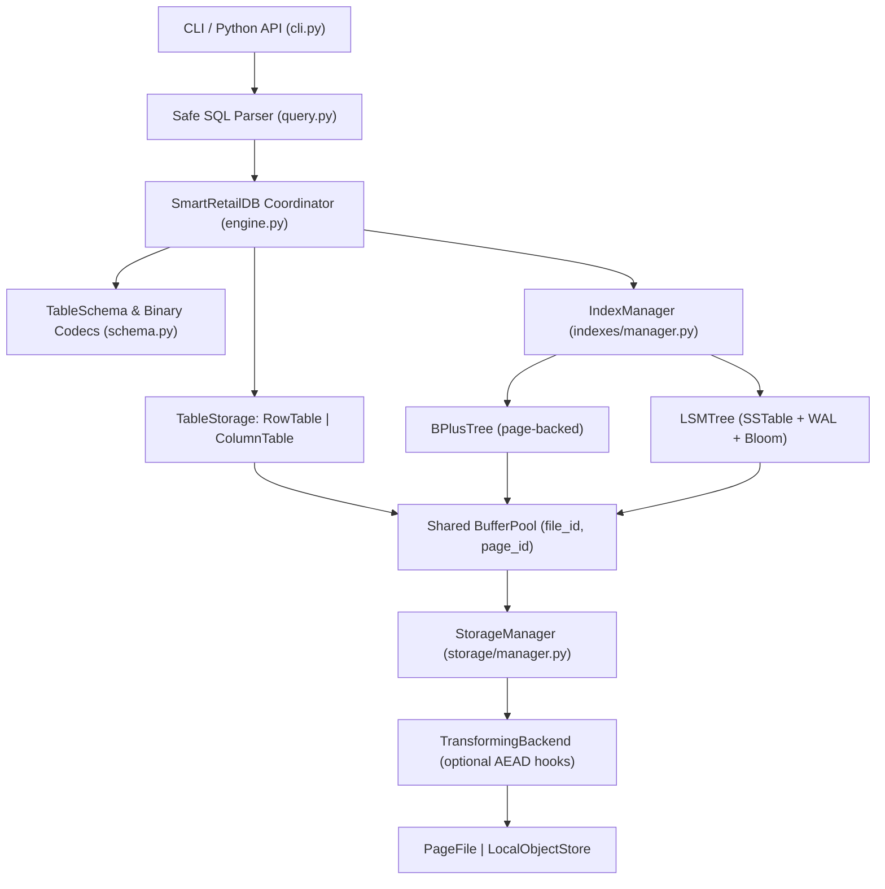

# Smart Retail DB — Architecture (M1 & M2)

This document specifies component boundaries, binary page formats, index storage structures, crash-consistency guarantees, and how upcoming milestones (M3–M5) integrate onto the M1/M2 engine.

---

## 1. Layered System Architecture



---

## 2. Core Components & Contracts

| Component | Module | Responsibility & Key Contract |
| :--- | :--- | :--- |
| **Schema & Key Codec** | [schema.py](file:///run/media/radwan/data/University/Year%204/Semester%201/Advanced%20DB/smart-retail-adb/src/smartdb/schema.py) | Defines `DataType`, `ColumnSpec`, `TableSchema`, `RID = tuple[int, int]`. Validates records before any disk/index mutation (`bool` never coerces to `int`; `NaN`/`Inf` rejected). Produces order-preserving byte keys (`encode_key`). |
| **Storage Manager** | [manager.py](file:///run/media/radwan/data/University/Year%204/Semester%201/Advanced%20DB/smart-retail-adb/src/smartdb/storage/manager.py) | Maps logical names (e.g. `table:Products:row`, `index:Products.price:bplus`) to integer `file_id`s and wraps `PageFile` or `LocalObjectStore` with `TransformingBackend` when encryption is configured. |
| **Shared Buffer Pool** | [buffer_pool.py](file:///run/media/radwan/data/University/Year%204/Semester%201/Advanced%20DB/smart-retail-adb/src/smartdb/storage/buffer_pool.py) | One DB-wide pool keyed by `(file_id, page_id)`. Enforces `pin_count == 0` before evicting under `FIFO` or `LRU`, supports `pin_page` context-managed pinning, avoids redundant read-misses on `new_page`, and checks `wal_flushed_lsn_fn` prior to dirty write-back. |
| **Row Table** | [row_table.py](file:///run/media/radwan/data/University/Year%204/Semester%201/Advanced%20DB/smart-retail-adb/src/smartdb/storage/row_table.py) | Slotted-page heap table (`RID = (page_id, slot_id)`). Preserves `slot_id` on delete, updates in-place when payload fits (relocating only on growth), and spills oversized rows/vectors into linked `OVERFLOW` pages. |
| **Column Table** | [column_table.py](file:///run/media/radwan/data/University/Year%204/Semester%201/Advanced%20DB/smart-retail-adb/src/smartdb/storage/column_table.py) | Per-column `PageBackend` streams + `deleted` bitmap (`RID = (0, rowid)`). Fixed-width columns compute `(page_id, slot)` in $O(1)$; variable-width columns binary-search a page-start directory. `scan_batches(fields=...)` reads only projected columns. |
| **B+ Tree Index** | [bplus_tree.py](file:///run/media/radwan/data/University/Year%204/Semester%201/Advanced%20DB/smart-retail-adb/src/smartdb/indexes/bplus_tree.py) | Page-backed B+ Tree (`BPLUS_META`, `BPLUS_INTERNAL`, `BPLUS_LEAF`). Leaf pages form a doubly-linked list (`next_page`/`prev_page`) for range scans and spill high-duplicity RIDs (>8) into linked `OVERFLOW` bucket pages. |
| **LSM Tree Index** | [lsm_tree.py](file:///run/media/radwan/data/University/Year%204/Semester%201/Advanced%20DB/smart-retail-adb/src/smartdb/indexes/lsm_tree.py) | Write-oriented index with entry-count memtable, buffered framed `memtable.wal`, and immutable SSTable runs stored through `StorageManager` + `BufferPool`. Keeps only `BloomFilter` + sparse fence pointers in RAM. |
| **Engine & Parser** | [engine.py](file:///run/media/radwan/data/University/Year%204/Semester%201/Advanced%20DB/smart-retail-adb/src/smartdb/engine.py), [query.py](file:///run/media/radwan/data/University/Year%204/Semester%201/Advanced%20DB/smart-retail-adb/src/smartdb/query.py) | Routes safe DDL/DML/SELECT ASTs, pushes projections down to tables, resolves equality/range predicates via indexes with SQL three-valued `NULL` filtering, and tracks per-table telemetry. |

---

## 3. Binary Page & File Formats

### 3.1 Physical Page Envelope & Common 24-Byte Header
Physical pages default to `4,096` bytes. When `TransformingBackend` wraps a backend with `overhead_bytes = 28` (e.g., `make_aes_gcm_hooks`: 12B nonce + ciphertext + 16B GCM tag, authenticated with `page_id` as AAD), `usable_page_size = 4,068` bytes while on-disk physical pages remain `4,096` bytes.

Every usable page begins with a 24-byte `PageHeader` (`struct "<BBHHHqii"`):

```text
+------------+-------+------------+------------+----------+-----+-----------+-----------+
| page_type  | flags | item_count | free_start | free_end | lsn | next_page | prev_page |
|    (1B)    | (1B)  |    (2B)    |    (2B)    |   (2B)   | (8B)|   (4B)    |   (4B)    |
+------------+-------+------------+------------+----------+-----+-----------+-----------+
0            1       2            4            6          8     16          20         24
```

- `page_type` (`PageType`): `ROW_SLOTTED (1)`, `OVERFLOW (2)`, `COL_FIXED (3)`, `COL_VAR (4)`, `BITMAP (5)`, `BPLUS_META (6)`, `BPLUS_INTERNAL (7)`, `BPLUS_LEAF (8)`, `LSM_DATA (9)`, `LSM_META (10)`, `COL_META (11)`.
- `lsn` (`int64`): initialized to `0`, reserved for M4 ARIES `pageLSN`.

### 3.2 `RowTable` Slotted Page & Binary Tuple Layout
```text
[ 24B Header ][ Slot 0 (off,len) ][ Slot 1 ] ... ->   <- ... [ Row 1 ][ Row 0 ]
                                          free_start  free_end
```
- Deleted slots mark `offset = 0xFFFF, length = 0` without shifting sibling `slot_id`s, keeping index RIDs stable.
- Each serialized row begins with a `ceil(num_cols / 8)`-byte null bitmap followed by packed column values (`<q` for `INT`, `<d` for `FLOAT`, `1B` for `BOOL`, `<I + utf8/bytes` for `STR`/`BYTES`, `<dim * f` `float32` for `VECTOR(dim)`, or `1B tag + payload` for `ANY`).
- Records exceeding single-page capacity write an `OVERFLOW` chain and store a 12-byte inline stub (`b"\xffOVF" + uint32 total_len + int32 first_ovf_page`).

### 3.3 `ColumnTable` Per-Column Storage
- **`COL_META`:** page `0` stores `row_count` (`uint64`).
- **`BITMAP`:** 1 bit per `rowid` (`1` = deleted).
- **`COL_FIXED` (`INT`, `FLOAT`, `BOOL`, inline `VECTOR`):** `[24B Header][null_bitmap][K fixed slots]`, giving $O(1)$ lookup at `page = rowid // K, slot = rowid % K`.
- **`COL_VAR` (`STR`, `BYTES`, `ANY`, oversized `VECTOR`):** `SlottedPage` storing `first_rowid` in `hdr.prev_page` and value payloads with `0=NULL`, `1=inline`, `2=overflow stub`.

### 3.4 `LSMTree` SSTable & WAL Layout
- **Memtable & WAL:** Mutations append `(seq, is_deleted, rid, key_bytes)` framed with `<I` length (encrypted via `encrypt_record` when set) to `memtable.wal` (`file.flush()`, `os.fsync()` on SSTable flush/compaction). Memtable flushes when `total_entries >= flush_threshold` (preventing unbounded RAM growth on low-cardinality columns).
- **SSTable Runs (`LSM_DATA` + `LSM_META`):** Sorted keys with `(rid, seq, is_deleted)` ops packed into `LSM_DATA` pages, followed by chained `LSM_META` pages storing `min_key`, `max_key`, serialized `BloomFilter` (`blake2b` double-hashing, 10 bits/key), and sparse `(first_key, data_page_id)` fence pointers.
- **Compaction:** Merges all runs + memtable keeping only live RIDs (resolving key-level and RID-level tombstones by `seq`), writes a new SSTable run, atomically swaps `manifest.json` via `.tmp` + `os.replace`, unregisters old runs from `BufferPool`, and deletes old files.

---

## 4. Key Architectural Decisions & Trade-offs

1. **Binary Slotted & Per-Column Pages vs. JSON-per-Page:** Eliminates $O(k^2)$ per-insert JSON re-serialization, enables true column projection I/O savings (`ColumnTable`), removes the 4 KB hard ceiling via `OVERFLOW` chains, and supports typed `VECTOR(D)` columns.
2. **Unified Buffer Pool (`(file_id, page_id)`) vs. Per-Table Pools:** Enforces global memory capacity across tables and indexes, supports pin-safe iterators/joins, and exposes `page_lsn`/`wal_flushed_lsn_fn` required by M4 ARIES.
3. **Lossless Numeric `encode_key` & Three-Valued `NULL`s:** `DataType.ANY` encodes numbers via bucket + `math.floor` `int64` + fractional `float64`, preserving `1 == 1.0` and full 64-bit integer precision while keeping `bool` strictly distinct from `int`. `NULL` sorts first in indexes and is explicitly filtered out by `<`, `<=`, `>`, `>=`, `BETWEEN` queries.
4. **Pre-M4 Crash-Consistency Boundary:** Before M4 introduces a DB-wide WAL, `SmartRetailDB` keeps write-back buffering for performance and records `clean_shutdown` in `catalog.json`. On reopen after `clean_shutdown == False`, `_reconcile_indexes()` rebuilds indexes from durable table pages and `try_get_record` safely guards against stale RIDs.
5. **Auto-Selection Rule:** `choose_index_type(reads, writes, range_reads=0)` selects `LSM` when `reads == 0 and range_reads == 0 and writes > 0`, or when `writes > reads * 2 and range_reads == 0`; otherwise it selects `BPLUS`.

---

## 5. Integration Path for Milestones 3–5

- **M3 (Query Processing Engine):**
  - `ColumnTable.scan_batches(fields=...)` already produces columnar `dict[str, list]` batches for vectorized `SELECT` and `JOIN` operators.
  - `TableSchema` + persisted `_table_stats` (`reads`, `writes`, `range_reads`) + `IndexManager.range_search` provide the metadata and access paths required by a cost-based optimizer.
- **M4 (Transactions & Recovery):**
  - `PageHeader.lsn`, `BufferFrame.page_lsn`/`rec_lsn`, and `BufferPool(..., wal_flushed_lsn_fn=...)` are already wired for ARIES steal/no-force WAL recovery.
  - `RowTable` stable `(page_id, slot_id)` slots and `ColumnTable` deleted bitmaps provide stable tuple anchors for MVCC version chains and row/page locks.
- **M5 (Distributed Layer & Exact Top-K Vector Search):**
  - `DataType.VECTOR(D)` and `OVERFLOW` pages persist arbitrary fixed-dimensional `float32` embeddings directly inside the custom storage engine.
  - `StorageManager` + `LocalObjectStore` provide a clean abstraction for node-local or shared-object storage alongside Raft/2PC coordination.
