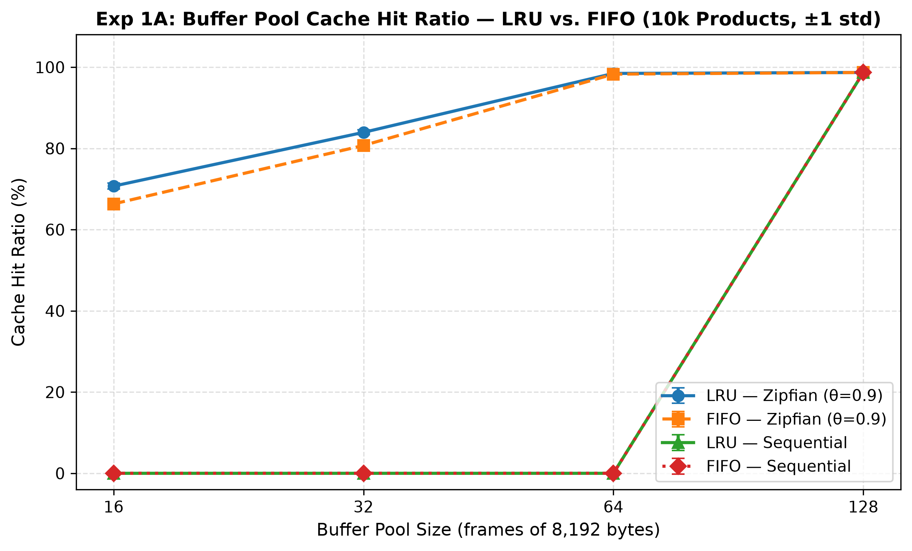
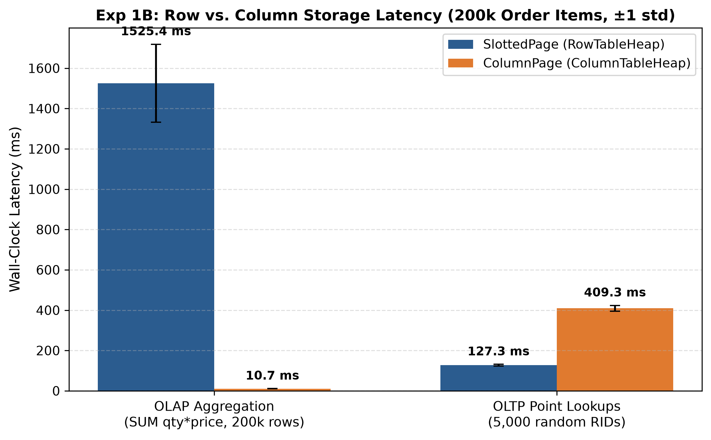
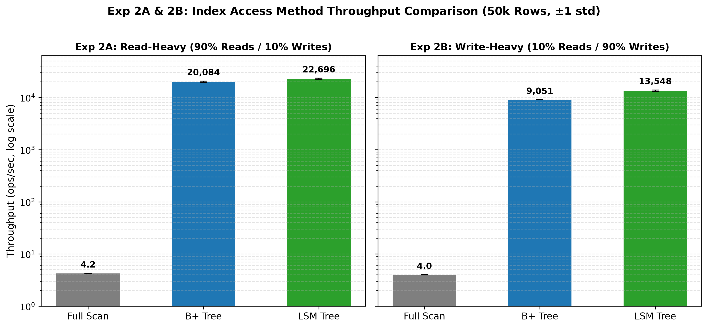
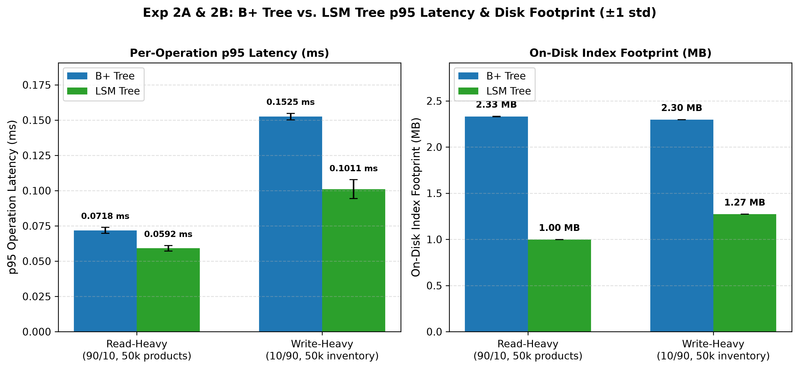
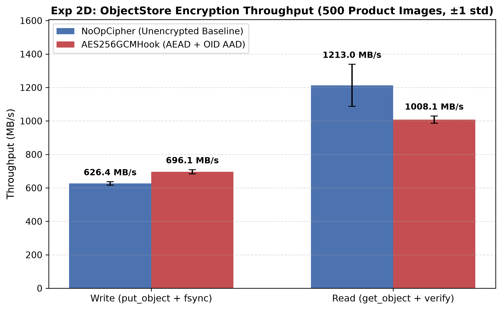

# Milestones 1 & 2 Technical Narrative — `csai302_db`

**System:** `csai302_db` (Custom Disk-Oriented Relational & Object DBMS — Retail Orders & Product Search)  
**Scope:** Milestone 1 (Storage Engine, Page Layouts, Buffer Pool) & Milestone 2 (Encrypted Object Store, B+ Tree, LSM Tree, Workload Advisor, Parameterized Query Shell)  
**Verification Baseline:** `summary_metrics.csv` & `env_metadata.json` (`seed=42`, `runs=5`, `warmup_runs=1`)

---

## 1. Design & Implementation Narrative

### 1.1 Milestone 1 — Storage Engine, Page Formats & Buffer Pool

`csai302_db` is built from first principles on a universal `8,192`-byte (`PAGE_SIZE = 8192`) physical page abstraction (`src/common/config.py`, `src/storage/page_header.py`, `src/storage/disk_manager.py`). Every relational heap page, columnar chunk page, Free Space Map (FSM) page, and B+ Tree node begins with a `32`-byte little-endian `PageHeader` (`<IBBHQIIQ`): `page_id` (`u32`), `page_type` (`u8`), `flags` (`u8`), `slot_count` (`u16`), `page_lsn` (`u64`, reserved for M4 ARIES WAL), `free_space_ptr` (`u32`), `next_page_id` (`u32`), and `checksum` (`u64`). On every `DiskManager.write_page()`, a 64-bit `BLAKE2b(digest_size=8)` digest is computed over `buf[0:24] + buf[32:8192]` and stamped into bytes `24..31`; every non-zero `DiskManager.read_page()` recomputes this digest and raises `PageCorruptedError` on any mismatch. Persistence uses positioned POSIX I/O (`os.pread` / `os.pwrite`) plus `os.fsync` so concurrent reads/writes never rely on a shared file cursor. Page `0` hosts the PageHeader plus an in-page FSM bitmap starting at `fsm_offset = 32` (`8,160` bytes = `65,280` data pages) for heaps/columns or `fsm_offset = 64` (`8,128` bytes = `65,024` data pages) for B+ Trees.

Memory management is mediated by `BufferPoolManager` (`src/storage/buffer_pool.py`) backed by fixed `8,192`-byte `FrameHeader` buffers and pluggable `ReplacementPolicy` implementations (`LRUReplacer` and `FIFOReplacer` in `src/storage/replacer.py`). Both replacers use `collections.OrderedDict` for $O(1)$ unpin/evict transitions; `FIFOReplacer` maintains a separate `_pinned` set alongside `_od` so cache hits shield pinned frames from eviction without resetting their original arrival order. `BufferPoolManager` enforces pin-count protection (raising `BufferPoolFullError` when all frames have `pin_count > 0`), reserves replacement frames in `new_page()` *before* calling `DiskManager.allocate_page()` so failed evictions never leak FSM bits, writes back dirty victims before reuse, and records exact `hit_count`, `miss_count`, `hit_ratio`, `eviction_write_count`, `disk_reads`, and `disk_writes` telemetry.

Two storage layouts share a unified 64-bit `RID(page_id, slot_id)` (`<II` in `src/common/types.py`):
* **`SlottedPage` & `RowTableHeap` (`src/storage/slotted_page.py`, `src/storage/table_heap.py`):** Used for OLTP tables (`customers`, `products`, `inventory`, `orders`). A forward-growing `<HH` slot directory (`32..32+4N`) indexes backward-growing tuples starting from byte `8192`. Every stored tuple begins with a `16`-byte `<QQ` MVCC header (`xmin = 1, xmax = 0` in M1–M2) followed by `Schema.encode_row()` bytes. Deletions zero `(0, 0)` without shifting subsequent slot indices, `compact()` defragments live tuples while keeping all `slot_id`s immutable, and `RowTableHeap.update()` relocates overflowing rows to a new `RID` before tombstoning the old slot.
* **`ColumnPage` & `ColumnTableHeap` (`src/storage/column_page.py`, `src/storage/table_heap.py`):** Used for the analytical `order_items` table (`*.col` per column). Fixed-width columns (`INT32`, `INT64`, `UINT64`, `FLOAT64`) pack C-contiguous elements from byte `32`, capping logical chunks at `CHUNK_ROWS = 1020` rows (`(8192 - 32) // 8`) so every column file advances in lockstep and `RID(page_id, slot_id)` addresses the same row across all `.col` files. `ColumnPage.as_numpy_array()` exposes zero-copy `np.frombuffer(..., offset=32)` views (`arr.flags["OWNDATA"] is False`), and `ColumnTableHeap.iter_batches(columns)` yields aligned `{col: np.ndarray}` chunks inside `try/finally` pin guards. `StorageEngine` (`src/storage/storage_engine.py`) coordinates all heaps, `ObjectStore`, and atomic `storage_meta.json` persistence.

### 1.2 Milestone 2 — Encrypted Object Store, Indexing & Query Shell

* **`ObjectStore` & `CipherHook` (`src/storage/object_store.py`, `src/storage/cipher_hooks.py`):** Variable-sized product images (`16 KB–128 KB`) are stored as sequential extent records in `objects/objects.dat` paired with an atomic `objects/objects.dir` index (`objects.dir.tmp -> os.fsync -> os.replace`). Each `objects.dat` record has a `48`-byte `<4sQII12s16s` header (`magic=b"OBJ1"`, `oid`, `raw_len`, `cipher_len`, `12B` nonce, `16B` GCM tag), `cipher_len` payload bytes, and a `4`-byte `<I` CRC32 trailer. `NoOpCipher` (`algorithm_id=0`) passes plaintext unmodified, whereas `AES256GCMHook` (`algorithm_id=1`) encrypts with a fresh 96-bit `os.urandom(12)` nonce per write and binds `aad = struct.pack("<Q", oid)` so cross-OID ciphertext swaps fail authentication with `SecurityViolationError` even if CRC32 is recomputed.
* **`BPlusTreeIndex` (`src/index/bplus_tree.py`):** A disk-backed B+ Tree over `8,192`-byte `DiskManager(..., fsm_offset=64)` + `BufferPoolManager` pages. Page `0` stores persistent metadata (`<IBHHQ?6x` at bytes `32..55`) and a `65,024`-page FSM (`64..8191`). `encode_key()` (`src/common/types.py`) converts signed integers (sign-bit flip) and IEEE-754 floats (`-0.0 -> +0.0`, negative bitwise inversion) into big-endian byte strings whose raw lexicographical order matches numeric order. Appending `>II(page_id, slot_id)` (`effective_key_size = key_size + 8`) handles duplicate secondary keys (`products.price`, `orders.order_date`) without overflow chains, yielding internal fanout `M_int = 407` and leaf capacity `M_leaf = 340` for 8-byte keys while maintaining `<= 2` pinned frames during traversal and sibling leaf range scans (`next_page_id`).
* **`LSMTreeIndex` (`src/index/lsm_tree.py`):** A three-tier write-optimized index combining: (1) a CRC32-framed `lsm.wal` (`<IBH` + `entry_key` + `<II` + `<I` CRC32) that truncates torn tails cleanly on recovery; (2) an in-memory sorted `MemTable` (`DEFAULT_MEMTABLE_BYTES = 1_048_576` = `1 MiB`); and (3) immutable `SSTable` runs composed of `8,192`-byte sorted data blocks, a SHA-256 double-hashing `BloomFilter` (`BLOOM_FPR = 0.01`, hashing *only* fixed-width user keys so composite duplicate keys avoid false negatives), a sparse fence index (`first_key, block_offset`), and a `64`-byte CRC32-protected EOF footer (`<8sQIIQIQQI8s`, `magic=b"CSAI_SST"`). `manifest.json` commits atomically before truncating `lsm.wal`, and size-tiered compaction (`LSM_COMPACTION_TRIGGER = 4`) merges runs via `heapq.merge` in recency order, dropping tombstones (`is_tombstone=1`) only when no older SSTables remain in deeper levels.
* **`WorkloadAdvisor`, `CatalogManager` & `SimpleExecutor` (`src/index/index_advisor.py`, `src/query/catalog.py`, `src/query/simple_executor.py`):** `WorkloadAdvisor` tracks per-`(table, column)` operations in a bounded sliding window (`deque(maxlen=1000)`), computing write fraction $\alpha = \text{writes} / N$ and range-read fraction $\beta = \text{range\_reads} / \text{reads}$ (`0.0` if no reads). It selects `FULL_SCAN` if $N < 200$ or `page_count < 4`, `LSM_TREE` if $\alpha > 0.45$ and $\beta < 0.25$, and `BPLUS_TREE` otherwise. `CatalogManager` persists table layouts, schemas, row/page counts, per-column `min_val`/`max_val`, and index registrations atomically to `catalog.json`. `SimpleExecutor` parses parameterized SQL (`SELECT`, `INSERT`, `UPDATE`, `DELETE`, `CREATE INDEX ... USING BTREE|LSM|AUTO`), rejects raw string literals/comments/tautologies/`UNION`/`OR` with `SecurityViolationError` (while malformed syntax raises `QuerySyntaxError`), routes predicates to active indexes or heap scans, and rolls back multi-row DML atomically on failure.

---

## 2. Experimental Setup & Reproducibility

All experiments were recorded in a single automated Gate 3 run (`results/m1_m2/env_metadata.json`, `results/m1_m2/summary_metrics.csv`, `total_elapsed_seconds = 651.844` s):

* **Platform & Hardware:** `Linux-7.2.15-1-omarchy-x86_64-with-glibc2.44` (`x86_64`, `16` CPUs)
* **Runtime Versions:** Python `3.14.8`, NumPy `2.5.5`, Matplotlib `3.11.2`
* **Engine Configuration:** `PAGE_SIZE = 8192`, `DEFAULT_BUFFER_POOL_SIZE = 64` frames (`512 KiB`), `DEFAULT_MEMTABLE_BYTES = 1048576` (`1 MiB`), `random_seed = 42`
* **Measurement Protocol:** `1` untimed warm-up trial followed by `5` measured trials per configuration (`warmup_runs = 1`, `runs = 5`), with correctness assertions executed before exporting timings and temporary directories cleaned between trials.

### Workload Summary & Sampling Methodology

| Experiment | Dataset & Scale | Access Methods Compared | Workload & Sampling Protocol |
| :--- | :--- | :--- | :--- |
| **1A** | `10,000` products (`65` pages) | `LRU` vs. `FIFO` (`pool_size` $\in \{16, 32, 64, 128\}$) | `5,000` page fetches/run under Zipfian ($\theta = 0.9$) and Sequential cyclic scans |
| **1B** | `200,000` `order_items` (`1,283` row pages vs. `197` aligned column pages/col) | `RowTableHeap` vs. `ColumnTableHeap` (`pool_size = 64`) | OLAP `SUM(qty * unit_price)` over `200,000` rows; OLTP `5,000` random `RID` point lookups across all 5 columns |
| **2A** | `50,000` products (initial sizes: B+ `2.2969` MB, LSM `0.9734` MB) | `BPLUS_TREE`, `LSM_TREE`, `FULL_SCAN` (`pool_size = 64`) | `10,000` shuffled ops (`7,000` point, `2,000` width-20 range, `1,000` inserts) for indexes; `FULL_SCAN` executes a **stratified `200`-op representative sample** (`140` point, `40` range, `20` inserts) from the identical shuffled stream |
| **2B** | `50,000` inventory rows (`shutil.copytree` clean baseline/trial) | `BPLUS_TREE`, `LSM_TREE`, `FULL_SCAN` (`pool_size = 64`) | `20,000` shuffled ops (`18,000` stock updates, `2,000` point lookups) for indexes; `FULL_SCAN` executes a **stratified `200`-op representative sample** (`180` updates, `20` point lookups) |
| **2C** | `4,150`-op synthetic trace (`table_pages = 323`) | `WorkloadAdvisor` (`window_size = 1000`) | 3 phases: `150` cold-start ops (50/50) $\to$ `2,000` 90%-write ops $\to$ `2,000` 85%-range-read ops |
| **2D** | `500` PNG-prefixed product images (`34.0083` MB raw, `16 KB–128 KB`) | `NoOpCipher` vs. `AES256GCMHook` (`ObjectStore`) | `500` sequential `put_object` + `flush()` writes followed by `500` `get_object` reads with byte-for-byte verification |

> [!NOTE]
> **FullTableScan Sampling Transparency (`env_metadata.json`):** Because an unindexed heap scan over `50,000` rows takes `~240–254 ms` per operation (`~2,400–5,085` seconds for `10,000–20,000` ops per trial), running `5` measured + `1` warmup trial at full length would require >10 hours. Instead, `FULL_SCAN` executes the exact stratified `200`-op sample (`140/40/20` in Exp 2A; `180/20` in Exp 2B) from the same shuffled workload, asserting identical `RID` and row results against the index runs and reporting exact per-operation latency (`mean_op_ms`, `median_op_ms`, `p95_op_ms`) and `throughput_ops_sec`.

**Reproduce Gate 3 (`results/m1_m2/`):**
```bash
.venv/bin/python -m bench.run_m1_m2_benchmarks --runs 5 --seed 42 --out-dir results/m1_m2
```

---

## 3. Measured Results & Quantitative Analysis

All numeric values below are taken directly from [`results/m1_m2/summary_metrics.csv`](../../results/m1_m2/summary_metrics.csv) and [`results/m1_m2/env_metadata.json`](../../results/m1_m2/env_metadata.json) (`runs = 5`).

### 3.1 Experiment 1A — Buffer Pool Hit Ratio & Eviction (`LRU` vs. `FIFO`)



| Workload | Policy | Pool Size | Mean Latency (ms) | Std Dev (ms) | Throughput (ops/s) | Mean Hit Ratio | Std Hit Ratio | Mean Disk Reads |
| :--- | :--- | :---: | :---: | :---: | :---: | :---: | :---: | :---: |
| `zipfian` | `LRU` | 16 | 61.6598 | 1.2479 | 81,116.9135 | 0.70716 | 0.007640 | 1,464.2 |
| `zipfian` | `LRU` | 32 | 51.2995 | 2.7719 | 97,686.4816 | 0.83948 | 0.006008 | 802.6 |
| `zipfian` | `LRU` | 64 | 37.1029 | 1.6290 | 134,962.9918 | 0.98464 | 0.000713 | 76.8 |
| `zipfian` | `LRU` | 128 | 36.1638 | 0.7142 | 138,301.7296 | 0.98700 | 0.000000 | 65.0 |
| `zipfian` | `FIFO` | 16 | 62.8685 | 2.5088 | 79,631.3886 | 0.66336 | 0.010285 | 1,683.2 |
| `zipfian` | `FIFO` | 32 | 50.1899 | 1.0888 | 99,659.3892 | 0.80724 | 0.010100 | 963.8 |
| `zipfian` | `FIFO` | 64 | 36.6027 | 0.5620 | 136,627.5689 | 0.98284 | 0.000623 | 85.8 |
| `zipfian` | `FIFO` | 128 | 37.3485 | 1.9022 | 134,157.8000 | 0.98700 | 0.000000 | 65.0 |
| `sequential` | `LRU` | 16 | 94.2823 | 2.6749 | 53,065.5454 | 0.00000 | 0.000000 | 5,000.0 |
| `sequential` | `LRU` | 32 | 92.9511 | 2.4376 | 53,821.3703 | 0.00000 | 0.000000 | 5,000.0 |
| `sequential` | `LRU` | 64 | 91.3738 | 3.6291 | 54,789.6833 | 0.00000 | 0.000000 | 5,000.0 |
| `sequential` | `LRU` | 128 | 23.4340 | 0.2566 | 213,385.8685 | 0.98700 | 0.000000 | 65.0 |
| `sequential` | `FIFO` | 16 | 93.1793 | 0.7249 | 53,662.5596 | 0.00000 | 0.000000 | 5,000.0 |
| `sequential` | `FIFO` | 32 | 91.9885 | 2.1194 | 54,378.1275 | 0.00000 | 0.000000 | 5,000.0 |
| `sequential` | `FIFO` | 64 | 91.7412 | 3.2135 | 54,553.6344 | 0.00000 | 0.000000 | 5,000.0 |
| `sequential` | `FIFO` | 128 | 22.7961 | 0.1189 | 219,340.6332 | 0.98700 | 0.000000 | 65.0 |

### 3.2 Experiment 1B — Row vs. Column Storage Layout (`200k` `order_items`)



| Workload | Layout (`access_method`) | Mean Latency (ms) | Median Latency (ms) | Std Dev (ms) | P95 Latency (ms) | Throughput (ops/s) | Mean Pages Read |
| :--- | :--- | :---: | :---: | :---: | :---: | :---: | :---: |
| `olap_aggregation` | `RowTableHeap` | 1,525.4227 | 1,542.7743 | 193.3807 | 1,717.2869 | 132,991.3848 | 1,283.0 |
| `olap_aggregation` | `ColumnTableHeap` | 10.6956 | 10.5399 | 0.5045 | 11.3550 | 18,731,659.5241 | 394.0 |
| `oltp_point_lookup` | `RowTableHeap` | 127.3085 | 128.5173 | 3.9732 | 129.7813 | 39,306.5610 | 4,755.8 |
| `oltp_point_lookup` | `ColumnTableHeap` | 409.3045 | 413.3759 | 14.0644 | 420.2407 | 12,227.8493 | 16,911.0 |

### 3.3 Experiments 2A & 2B — Index Throughput, Per-Op P95 Latency & Disk Footprint





| Exp & Workload | Access Method | Mean Run (ms) | Mean Op (ms) | Median Op (ms) | P95 Op (ms) | Std P95 Op (ms) | Throughput (ops/s) | Std Throughput | Build Time (ms) | Disk Size (MB) | Disk Reads | Disk Writes | Flushes |
| :--- | :--- | :---: | :---: | :---: | :---: | :---: | :---: | :---: | :---: | :---: | :---: | :---: | :---: |
| **2A** (`read_heavy_90_10`) | `BPLUS_TREE` | 514.3757 | 0.050853 | 0.053841 | 0.071843 | 0.002059 | 19,452.8743 | 546.2097 | 548.6097 | 2.329687 | 7,417.2 | 370.8 | 0.0 |
| **2A** (`read_heavy_90_10`) | `LSM_TREE` | 430.9111 | 0.042227 | 0.041679 | 0.059165 | 0.001953 | 23,225.3080 | 729.0141 | 344.9385 | 0.998137 | 9,086.0 | 0.0 | 2.0 |
| **2A** (`read_heavy_90_10`) | `FULL_SCAN` (200 ops) | 48,000.1734 | 239.997379 | 245.047061 | 334.072320 | 1.901530 | 4.1668 | 0.0304 | 0.0000 | 0.000000 | 58,140.2 | 17.0 | 0.0 |
| **2B** (`write_heavy_10_90`) | `BPLUS_TREE` | 2,232.1819 | 0.110707 | 0.118433 | 0.152483 | 0.002290 | 8,961.0635 | 116.4383 | 0.0000 | 2.296875 | 15,915.6 | 14,481.2 | 0.0 |
| **2B** (`write_heavy_10_90`) | `LSM_TREE` | 1,528.7552 | 0.073242 | 0.073368 | 0.101057 | 0.006672 | 13,107.9009 | 636.3351 | 0.0000 | 1.272644 | 16,794.2 | 0.0 | 1.0 |
| **2B** (`write_heavy_10_90`) | `FULL_SCAN` (200 ops) | 50,845.3746 | 254.224172 | 245.685543 | 318.797948 | 2.181522 | 3.9337 | 0.0302 | 0.0000 | 0.000000 | 54,291.2 | 180.0 | 0.0 |

*(Note: For `LSM_TREE`, `Disk Reads` reports SSTable 8 KB `block_reads`, and `Mean Compactions = 0.0` across all 2A/2B runs.)*

### 3.4 Experiment 2C — `WorkloadAdvisor` Dynamic Adaptation Trace

| Phase (`workload`) | Phase Ops | Window `n_ops` | Selected Strategy (`access_method`) | Mean $\alpha$ | Std $\alpha$ | Mean $\beta$ | Std $\beta$ | Trial-0 $(\alpha, \beta)$ | Mean Eval Time (ms) |
| :--- | :---: | :---: | :--- | :---: | :---: | :---: | :---: | :---: | :---: |
| `phase1_cold_start` | 150 | 150 | `FULL_SCAN` | 0.500000 | 0.000000 | 0.000000 | 0.000000 | `(0.5, 0.0)` | 0.043941 |
| `phase2_write_heavy_90` | 2,000 | 1,000 | `LSM_TREE` | 0.903000 | 0.008000 | 0.000000 | 0.000000 | `(0.896, 0.0)` | 0.468252 |
| `phase3_range_heavy_85` | 2,000 | 1,000 | `BPLUS_TREE` | 0.048800 | 0.003033 | 0.902450 | 0.005980 | `(0.047, 0.8972)` | 0.468659 |

### 3.5 Experiment 2D — `ObjectStore` Encryption Throughput & Overhead (`500` Images, `34.0083` MB Raw)



| Cipher Hook | Operation | Mean Latency (ms) | Std Dev (ms) | Mean Throughput (MB/s) | Std Throughput (MB/s) | Throughput (ops/s) | Disk Footprint (MB) | Storage Overhead (%) |
| :--- | :--- | :---: | :---: | :---: | :---: | :---: | :---: | :---: |
| `NoOpCipher` | `put_object` | 54.3063 | 0.8936 | 626.3661 | 10.2345 | 9,209.0146 | 34.044559 | 0.106584 |
| `NoOpCipher` | `get_object` | 28.2562 | 2.6534 | 1,212.9770 | 125.5513 | 17,833.5370 | 34.044559 | 0.106584 |
| `AES256GCMHook` | `put_object` | 48.8710 | 0.8604 | 696.0506 | 12.1420 | 10,233.5361 | 34.044559 | 0.106584 |
| `AES256GCMHook` | `get_object` | 33.7477 | 0.7153 | 1,008.0785 | 21.0816 | 14,821.0610 | 34.044559 | 0.106584 |

---

## 4. Hypothesis vs. Observation Discussion

### 4.1 Experiment 1A: Zipfian Hit-Ratio Separation & Sequential Thrashing Cliff
* **Hypothesis:** Under skewed Zipfian lookups ($\theta = 0.9$), `LRU` should retain hot head pages across repeat accesses and outperform `FIFO` at constrained pool sizes, whereas cyclic sequential scans larger than `pool_size` should thrash both policies at `0%` hit ratio until `pool_size >= working_set_pages`.
* **Observation:** Confirmed cleanly. At `pool_size = 16`, `LRU` achieves a `70.72%` (`0.70716`) hit ratio (`1,464.2` disk reads) versus `66.34%` (`0.66336`, `1,683.2` disk reads) for `FIFO` — a `+4.38` percentage-point advantage (`+3.22` pp at `pool_size = 32`: `83.95%` vs. `80.72%`). Under sequential scans across the `65`-page `products` heap, both policies suffer complete sequential flooding (`0.00%` hit ratio, `5,000.0` disk reads) for `pool_size <= 64`, then jump abruptly to `98.70%` (`0.987`, `65.0` cold-miss disk reads out of `5,000` fetches) at `pool_size = 128` once the entire `65`-page working set fits in memory.

### 4.2 Experiment 1B: Columnar OLAP Acceleration vs. Row OLTP Lookup Locality
* **Hypothesis:** `ColumnTableHeap` should vastly outperform `RowTableHeap` on `SUM(qty * unit_price)` by reading only `2` of `5` columns (`qty`, `unit_price`) in contiguous zero-copy NumPy arrays, while `RowTableHeap` should win on full-row OLTP point lookups (`RID`) because it fetches 1 page instead of 5 column files.
* **Observation:** Confirmed with stark contrast. On `200,000` `order_items` rows, `ColumnTableHeap` completes the OLAP aggregation in **`10.70 ms`** (`10.6956 ms`, `394` pages read = `197 * 2` projected columns, `18.73M rows/s`) compared to **`1,525.42 ms`** (`1,525.4227 ms`, `1,283` pages read, `132,991 rows/s`) for `RowTableHeap` — a **`142.6x` speedup** (`1525.4227 / 10.6956`) driven by both `3.26x` fewer disk reads and vectorized C-level NumPy arithmetic eliminating per-tuple Python `struct` unpacking. Conversely, on `5,000` random full-row `RID` lookups, `RowTableHeap` finishes in **`127.31 ms`** (`4,755.8` pages read, `39,307 ops/s`) versus **`409.30 ms`** (`16,911.0` pages read across 5 column files, `12,228 ops/s`) for `ColumnTableHeap` — **`3.22x` faster** due to single-page tuple co-location.

### 4.3 Experiments 2A & 2B: B+ Tree vs. LSM Tree Under Read-Heavy and Write-Heavy Workloads
* **Hypothesis:** Both indexes should beat `FULL_SCAN` by orders of magnitude; `LSM_TREE` should dominate on the 10/90 write-heavy workload (`Exp 2B`) via sequential MemTable/WAL buffering, while `BPLUS_TREE` was expected to tie or edge ahead on the 90/10 read-heavy workload (`Exp 2A`) with `20%` range scans.
* **Observation:**
  1. **Index vs. Full Scan:** Both indexes outperform `FULL_SCAN` (`4.17 ops/s` in Exp 2A, `3.93 ops/s` in Exp 2B) by **`4,668x–5,574x`** in Exp 2A and **`2,278x–3,332x`** in Exp 2B.
  2. **Write-Heavy 10/90 (`Exp 2B`):** As hypothesized, `LSM_TREE` beats `BPLUS_TREE` cleanly: **`13,107.90 ops/s`** (`0.1011 ms` P95, **`1.27 MB`** on disk, `1.0` flush) versus **`8,961.06 ops/s`** (`0.1525 ms` P95, **`2.30 MB`** on disk, `14,481.2` buffer pool page writes) — **`1.46x` higher throughput** and **`1.80x` smaller footprint**.
  3. **Read-Heavy 90/10 (`Exp 2A`) — Important Nuance:** Contrary to the naive textbook expectation, `LSM_TREE` (`23,225.31 ops/s`, `0.0592 ms` P95) also edged out `BPLUS_TREE` (`19,452.87 ops/s`, `0.0718 ms` P95) by `~19.4%` on Exp 2A. Inspection of the telemetry explains why: at `50,000` 8-byte integer keys (`~0.97 MB` initial SSTable), the `1 MiB` `MemTable` absorbed the `1,000` inserts in RAM (`2.0` flushes including initial build + end-of-run flush, `0` compactions) while `SSTable` data blocks were cached in the OS page cache and `BloomFilter` + sparse fence indexes jumped straight to target blocks; meanwhile, `BPLUS_TREE` operated through a `64`-frame (`512 KiB`) user-space `BufferPoolManager` (`2.33 MB` index > `512 KiB` pool), incurring `7,417.2` `DiskManager` reads + BLAKE2b checksum verifications and `370.8` dirty page write-backs. At larger datasets where `SSTable` count and `L0` overlap exceed MemTable/OS-cache ratios or trigger multi-level compactions, B+ Tree's bounded $O(\log_{340} N)$ leaf-sibling scan becomes increasingly advantageous.

### 4.4 Experiment 2C: `WorkloadAdvisor` Dynamic Adaptation
* **Hypothesis:** Feeding a cold-start trace, a 90%-write burst, and an 85%-range-read burst should drive deterministic transitions `FULL_SCAN -> LSM_TREE -> BPLUS_TREE`.
* **Observation:** Confirmed across all `5` measured trials (`std = 0` on strategy selection). Starting from `phase1_cold_start` (`N = 150 < 200`, $\alpha = 0.500$, $\beta = 0.000$), Rule 1 holds `FULL_SCAN`; after `2,000` 90%-write operations (`window_n_ops = 1,000`, mean $\alpha = 0.903$, mean $\beta = 0.000$), Rule 2 triggers `LSM_TREE` ($\alpha > 0.45, \beta < 0.25$); after `2,000` 85%-range operations (`window_n_ops = 1,000`, mean $\alpha = 0.0488$, mean $\beta = 0.90245$), Rule 3 switches to `BPLUS_TREE`.

### 4.5 Experiment 2D: `AES256GCMHook` Cost & Framing Overhead
* **Hypothesis:** `AES-256-GCM` authenticated encryption should preserve small framing overhead while adding modest cryptographic CPU overhead relative to `NoOpCipher`.
* **Observation:** Across `500` images (`34.0083 MB` raw), the `48`-byte `OBJ1` header + `4`-byte CRC32 + `objects.dir` metadata add exactly **`+0.1066%`** (`+0.107%`, `34.0446 MB` total) for both hooks because `CipherPayload` reserves fixed `12B` nonce + `16B` tag slots in the uniform envelope. On `get_object` reads from hot page cache, `AES256GCMHook` sustains **`1,008.08 MB/s`** versus **`1,212.98 MB/s`** for `NoOpCipher` (`~16.9%` throughput reduction from tag verification and decryption). On `put_object`, `AES256GCMHook` (`696.05 MB/s`) and `NoOpCipher` (`626.37 MB/s`) are both bottlenecked by `os.pwrite` + `os.fsync` I/O (`~48.9–54.3 ms`), demonstrating that hardware-accelerated AES-GCM (`cryptography` / OpenSSL) adds negligible write latency compared to disk durability.

---

## 5. Known Limitations

1. **Single-Process Concurrency Model:** Thread safety uses in-process `threading.RLock` hierarchies without cross-process OS `fcntl` file locks or shared-memory buffer pools; multiple OS processes must not open the same database directory concurrently.
2. **Single-Page FSM File Ceiling:** Page `0` stores a single-page FSM bitmap (`65,280` pages $\approx 510$ MiB at `fsm_offset=32`; `65,024` pages $\approx 508$ MiB at `fsm_offset=64`). Exceeding this ceiling per file requires multi-extent FSM chaining in a future milestone.
3. **Synchronous LSM Compaction:** In M2, `LSMTreeIndex.flush()` triggers `compact()` synchronously on the caller's thread when a level reaches `LSM_COMPACTION_TRIGGER = 4`, introducing tail-latency spikes during sustained multi-flush ingestion until background compaction threads are added.
4. **Monotonic Catalog `min_val` / `max_val` on Deletes:** `CatalogManager.update_table_stats()` expands `min_val`/`max_val` incrementally on inserts/updates but does not shrink bounds when the extreme row is deleted or updated, requiring periodic catalog statistics refreshes for tight M3 CBO selectivity estimates after heavy deletes.
5. **Uncompacted Dead Extents in `ObjectStore` & Single-Page Row Limit:** `ObjectStore.delete_object()` removes the OID from `objects.dir` without reclaiming dead extent bytes in `objects.dat` until offline compaction; similarly, `SlottedPage` bounds individual row payloads to `8,140` bytes (`8192 - 32 - 4 - 16`).
