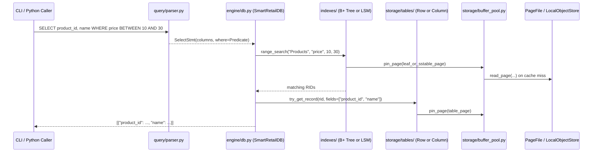

# Project Overview — Smart Retail DB

Smart Retail DB is a custom database management system (DBMS) built from scratch in pure Python for **CSAI 302 (Advanced Database Systems)**. Instead of wrapping an existing engine like SQLite or PostgreSQL, the project implements persistent page storage, buffer management, row and columnar table engines, B+ Tree and LSM Tree indexes, and a restricted SQL engine directly.

---

## 1. How the Course Milestones Fit Together

Every milestone extends the **same** database engine rather than building separate standalone scripts:

| Milestone | Status | What It Adds to the Engine |
| :--- | :--- | :--- |
| **M1 — Storage Engine Foundation** | Implemented | Fixed 4,096-byte persistent pages, shared `BufferPool` (`LRU`/`FIFO`), binary `RowTable` and `ColumnTable` layouts, and policy/layout benchmarks. |
| **M2 — Advanced Indexing System** | Implemented | Page-backed `BPlusTree`, disk-backed SSTable `LSMTree` (Bloom filters, fence pointers, WAL, compaction), `LocalObjectStore`, `TransformingBackend` encryption hooks, `auto` workload selection, and safe SQL/DML queries. |
| **M3 — Query Processing Engine** | Next | Vectorized `SELECT`/`JOIN` operators (building on `ColumnTable.scan_batches`), multiple join algorithms, cost-based optimizer, plan visualization, ORM API, and TPC-H queries. |
| **M4 — Transactions & Recovery** | Planned | MVCC isolation levels, lock manager with deadlock detection, and ARIES WAL recovery (building on `PageHeader.lsn` and `BufferPool.wal_flushed_lsn_fn`). |
| **M5 — Distributed Layer** | Planned | Sharding, replication, Raft consensus, 2PC, and exact top-$k$ vector similarity search (building on `DataType.VECTOR(D)` and `StorageManager`). |
| **M6 — Full System Integration** | Planned | End-to-end integration demo, scalability/failure experiments, and formal technical report. |

---

## 2. The Retail Orders Domain

The demonstration dataset generated by [generate_retail_data.py](../workloads/generate_retail_data.py) models five relational tables:

- **`Products`** (`product_id`, `name`, `category`, `price`, `stock`) — catalog items queried by ID, category, or price range.
- **`Customers`** (`customer_id`, `name`, `email`, `region`) — customer directory partitioned by region in later milestones.
- **`Orders`** (`order_id`, `customer_id`, `order_date`, `total_amount`) — customer purchase headers.
- **`OrderItems`** (`order_item_id`, `order_id`, `product_id`, `quantity`, `unit_price`) — line items joining orders to products.
- **`Inventory`** (`product_id`, `warehouse_id`, `quantity_on_hand`, `last_updated`) — per-warehouse stock updated alongside orders in M4 transactions.

---

## 3. End-to-End Request Lifecycle

When a user or application runs SQL through the CLI (`cli.py`) or `SmartRetailDB.execute(sql)`:

1. **Parsing & Safety:** `parse_sql()` matches a strict grammar and evaluates literals with `ast.literal_eval` — rejecting arbitrary SQL expressions or injection payloads (e.g., `OR 1=1`).
2. **Planning & Telemetry:** `SmartRetailDB` records read/write/range counts per table and checks `IndexManager` for an index on the `WHERE` column.
3. **Execution:**
   - **Indexed path:** Fetches candidate `RID`s from `BPlusTree` or `LSMTree`, reads only the matching rows/columns from `RowTable` or `ColumnTable`, and applies SQL three-valued `NULL` checks.
   - **Scan path:** Scans only the needed columns (`ColumnTable` skips all unprojected column files completely).
4. **Durability:** Dirty table and `BPlusTree` pages stay buffered in `BufferPool` until eviction, `flush()`, or `db.close()`. `LSMTree` also appends mutations to `memtable.wal` and flushes sorted SSTables automatically when entries reach `flush_threshold`.

---

## 4. Understanding the Benchmarks

| Benchmark | Question It Answers | Expected Result |
| :--- | :--- | :--- |
| **`benchmark_storage.py` (Policy)** | Does `LRU` reduce disk I/O compared to `FIFO` on skewed hot/cold traces? | `LRU` achieves a higher cache hit rate and fewer `disk_reads`. |
| **`benchmark_storage.py` (Layout)** | Why support both `RowTable` and `ColumnTable`? | `ColumnTable` is significantly faster with fewer page reads on narrow column projections (`SELECT product_id, price`), while `RowTable` excels at single-row inserts and full-row fetches. |
| **`benchmark_storage.py` (Backend)** | What is the cost of `LocalObjectStore` or AES-256-GCM page encryption? | Quantifies per-object filesystem overhead and AEAD crypto latency vs. plain contiguous `PageFile`. |
| **`benchmark_indexes.py` (Scan vs Index)** | How much faster is indexed lookup than scanning every page? | `BPlusTree` and `LSMTree` point lookups run orders of magnitude faster than `full_scan`. |
| **`benchmark_indexes.py` (B+ vs LSM)** | When does `choose_index_type` pick `LSM` vs `BPLUS`? | `LSMTree` wins on write-heavy workloads (batched sequential SSTable writes); `BPlusTree` wins on range scans (linked leaf pages without multi-run merging). |
